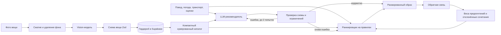

# Digital Wardrobe — гибридная AI-система подбора образов

[](https://github.com/w4ngle/digital-wardrobe/actions/workflows/ci.yml)
[](https://nextjs.org/)
[](https://www.typescriptlang.org/)
[](https://supabase.com/)

Telegram Mini App, которая превращает фотографии одежды в структурированные данные и подбирает образы с помощью **гибридного ML-пайплайна и детерминированных правил**. Система объединяет мультимодальное распознавание вещей, управляемую генерацию LLM, проверку предметных ограничений, резервное ранжирование и обратную связь пользователя.

**Рабочая версия:** [digital-wardrobe-gilt.vercel.app](https://digital-wardrobe-gilt.vercel.app) · Доступ ограничен разрешёнными Telegram-пользователями, поскольку фотографии гардероба являются личными данными.

## Ценность проекта для ML / Data Science

Главная часть проекта — не единичный вызов модели, а система принятия решений вокруг неё:

- преобразует неструктурированные фотографии одежды в проверенную схему признаков;
- представляет гардероб как компактный каталог для контекста LLM;
- учитывает погоду, повод, транспорт, доступность вещей и предпочтения пользователя;
- проверяет сгенерированные образы по строгим предметным ограничениям;
- повторяет запрос при некорректном ответе модели и использует детерминированный ранжировщик как fallback;
- адаптирует веса предпочтений по оценкам и отклонённым сочетаниям;
- отделяет офлайн-проверку ограничений от продуктовой аналитики и оценки качества модели.

Метрики в репозитории не выдаются за точность модели в реальных условиях. Тесты измеряют соблюдение детерминированных ограничений на синтетических данных; для оценки production-качества нужен анонимизированный размеченный датасет.

## Возможности продукта

- каталог гардероба с загрузкой фото, удалением фона и AI-разметкой;
- подбор образов на каждый день, для мероприятий, университета, тренировок и пляжа;
- учёт обязательной вещи, погоды, дождя, транспорта и давно не надетых вещей;
- замена и фиксация отдельных вещей, временное скрытие и управление доступностью;
- оценки, сохранённые образы, календарь, история носки и цикл стирки;
- автоматическая и ручная сборка чемодана с погодой и редактируемым списком;
- Telegram-аутентификация, утренние и вечерние сценарии, предложения образов между двумя пользователями;
- адаптивный mobile-first интерфейс и демонстрационный гардероб.

## ML-система



### Признаки ранжирования

| Сигнал | Роль |
|---|---|
| Категория и слой | Формируют структурно полный образ |
| Теплота и сезон | Учитывают температуру и верхний слой |
| Формальность и повод | Разделяют повседневные, деловые и праздничные образы |
| Стиль и пригодность для тренировки | Задают ограничения для активности |
| Сочетаемость цветов | Оценивает сочетание, а не отдельную вещь |
| Комфорт и уверенность | Персональный сигнал полезности |
| Доступность и временное скрытие | Исключают вещь из текущих кандидатов |
| Дата последней носки | Помогает возвращать забытые вещи |
| Оценки и отклонённые сочетания | Обеспечивают простую онлайн-персонализацию |

Предпосылки, валидация, схема оценки, ограничения и следующие эксперименты описаны в [карточке ML-системы](docs/ML_SYSTEM.md).

## Оценка и контроль качества

```bash
npm run test:eval   # проверка ограничений рекомендательной системы
npm test            # модульные и регрессионные тесты
npm run lint
npm run typecheck
npm run build:ci
```

Набор проверяет безопасность пляжных образов, пригодность вещей для тренировки, слои для холодной погоды, обязательные вещи и исключение недоступных вещей. CI запускается при каждом push и pull request.

## Архитектура

```text
app/                    страницы Next.js и защищённые серверные маршруты
components/             mobile-first интерфейс
lib/ai/                 провайдеры, промпты, схемы, каталог и валидация
lib/recommendations.ts  детерминированное ранжирование и fallback-алгоритм
eval/                   воспроизводимая проверка ограничений
supabase/migrations/    миграции схемы PostgreSQL
scripts/                генерация синтетических демоданных
docs/                   карточка ML-системы и документация проекта
```

Браузер не получает секретные ключи AI или Supabase. Вызовы AI, доступ к каталогу и проверка Telegram-сессии выполняются в серверных маршрутах.

## Локальный запуск

Требования: Node.js 22+, проект Supabase и, при необходимости, API-ключ Gemini или OpenAI.

```bash
git clone https://github.com/w4ngle/digital-wardrobe.git
cd digital-wardrobe
npm ci
cp .env.example .env.local
```

Примените миграции из `supabase/migrations/` по порядку, настройте `.env.local` и выполните `npm run dev`.

Основные переменные описаны в [.env.example](.env.example). Предпочтительный провайдер — Gemini (`GEMINI_API_KEY`), OpenAI используется как резервный.

## Данные и конфиденциальность

- Настоящие фотографии гардероба и приватные данные оценки не хранятся в Git.
- Изображения демонстрационного каталога синтетические или принадлежат проекту.
- Доступ к развёрнутому приложению ограничен списком Telegram ID.
- Загруженные фотографии обрабатываются только для функций гардероба.
- Секреты хранятся в серверных переменных окружения и исключены из Git.

Перед развёртыванием своего экземпляра ознакомьтесь с [SECURITY.md](SECURITY.md).

## Инженерные решения

- типизированные границы доверия с Zod;
- резервирование между Gemini и OpenAI;
- цепочка validation → retry → fallback вместо доверия сгенерированному JSON;
- вложенные запросы Supabase без N+1 при загрузке образов;
- детерминированные тесты критичных ограничений рекомендаций;
- обратимые демоданные и явный жизненный цикл доступности вещи;
- production-развёртывание в Vercel с плановыми Telegram-маршрутами.

## Планы развития

- анонимизированные события обратной связи и снимки офлайн-экспериментов;
- метрики constraint pass rate, coverage, diversity и acceptance@k;
- временное разделение train/validation после накопления взаимодействий;
- калибровка уверенности распознавания вещей и учёт ручных исправлений;
- pairwise-ранжирование или learning-to-rank после сбора достаточного объёма несмещённой обратной связи.

## Лицензия

[MIT](LICENSE). Не используйте личные данные гардероба или сторонние изображения без разрешения.
