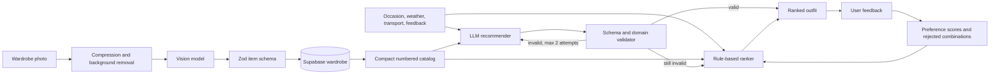

# Digital Wardrobe — hybrid AI outfit recommender

[](https://github.com/w4ngle/digital-wardrobe/actions/workflows/ci.yml)
[](https://nextjs.org/)
[](https://www.typescriptlang.org/)
[](https://supabase.com/)

Production-oriented Telegram Mini App that turns wardrobe photos into structured data and recommends outfits using a **hybrid ML + deterministic rules pipeline**. The system combines multimodal item extraction, constrained LLM generation, domain validation, fallback ranking and explicit user feedback.

**Live app:** [digital-wardrobe-gilt.vercel.app](https://digital-wardrobe-gilt.vercel.app) · Access is restricted to configured Telegram users because wardrobe photos are private.

## Why this project is relevant to ML / Data Science

The interesting part is not a single model call. It is the decision system around it:

- converts unstructured clothing photos into a validated feature schema;
- represents a wardrobe as a compact catalog suitable for LLM context;
- combines weather, occasion, transport, availability and user preferences;
- validates generated outfits against hard domain constraints;
- retries invalid model output and falls back to a deterministic ranker;
- learns lightweight preference scores from likes, dislikes and rejected combinations;
- separates offline constraint evaluation from product analytics and model quality claims.

No benchmark number in this repository is presented as real-world model accuracy. The included evaluation suite measures deterministic constraint compliance on synthetic fixtures; production quality still requires an anonymized labeled dataset.

## Product capabilities

- wardrobe catalog with photo upload, background removal and AI-assisted metadata;
- outfit recommendation for everyday use, events, university, training and beach scenarios;
- mandatory-item, weather, rain, transport and “rediscover old items” controls;
- item-level replacement, locking, temporary suppression and availability states;
- likes/dislikes, saved outfits, calendar, wear history and laundry cycle;
- automatic and manual trip packing with destination weather and editable checklists;
- Telegram authentication, morning/evening flows and two-user outfit proposals;
- responsive mobile-first UI with a seeded demo wardrobe.

## ML system



### Features used by the ranker

| Signal | Role |
|---|---|
| Category and layer | Enforces a structurally complete outfit |
| Warmth and season | Matches temperature and cold-weather layers |
| Formality and occasion | Separates daily, business and event outfits |
| Style and training suitability | Applies activity-specific constraints |
| Color compatibility | Scores combinations rather than isolated items |
| Comfort and confidence | Personal utility signal |
| Availability and snooze state | Hard exclusion from current candidates |
| Last worn date | Supports wardrobe rediscovery |
| Likes and rejected combinations | Lightweight online personalization |

See the [ML system card](docs/ML_SYSTEM.md) for assumptions, validation, evaluation design, limitations and next experiments.

## Evaluation and quality gates

```bash
npm run test:eval   # recommendation constraint evaluation
npm test            # unit and regression tests
npm run lint
npm run typecheck
npm run build:ci
```

The evaluation set covers beach safety, training suitability, cold-weather layers, mandatory items and unavailable-item exclusion. CI runs on every push and pull request.

## Architecture

```text
app/                    Next.js pages and authenticated server routes
components/             mobile-first product UI
lib/ai/                 providers, prompts, schemas, catalog and validation
lib/recommendations.ts  deterministic ranking and fallback engine
eval/                   reproducible constraint evaluation
supabase/migrations/    PostgreSQL schema evolution
scripts/                synthetic demo-data seeding
docs/                   ML system card and project documentation
```

The browser never receives AI or Supabase secret keys. AI calls, catalog access and Telegram session verification happen on server routes.

## Local setup

Requirements: Node.js 22+, a Supabase project and optionally a Gemini or OpenAI API key.

```bash
git clone https://github.com/w4ngle/digital-wardrobe.git
cd digital-wardrobe
npm ci
cp .env.example .env.local
```

Apply migrations from `supabase/migrations/` in numeric order, configure `.env.local`, then run `npm run dev`.

Important variables are documented in [.env.example](.env.example). `GEMINI_API_KEY` is preferred; OpenAI is the fallback provider.

## Data and privacy

- Real wardrobe photos and private evaluation data are not stored in Git.
- Demo catalog images are synthetic or project-owned fixtures.
- Access to the deployed app is allow-listed through Telegram user IDs.
- Uploaded photos are processed only for wardrobe functionality.
- Secrets are server-side environment variables and are ignored by Git.

See [SECURITY.md](SECURITY.md) before deploying your own instance.

## Engineering highlights

- typed trust boundaries with Zod;
- provider fallback between Gemini and OpenAI;
- validation/retry/fallback instead of trusting generated JSON;
- nested Supabase reads to avoid outfit N+1 queries;
- deterministic tests for high-risk recommendation constraints;
- reversible demo data and explicit availability lifecycle;
- production deployment on Vercel with scheduled Telegram routes.

## Roadmap

- anonymized feedback event table and offline experiment snapshots;
- ranking metrics such as constraint pass rate, coverage, diversity and acceptance@k;
- temporal train/validation split once enough interactions exist;
- calibrated item-analysis confidence and human correction tracking;
- pairwise or learning-to-rank model after collecting sufficient unbiased feedback.

## License

[MIT](LICENSE). Do not reuse private wardrobe data or third-party images without permission.
